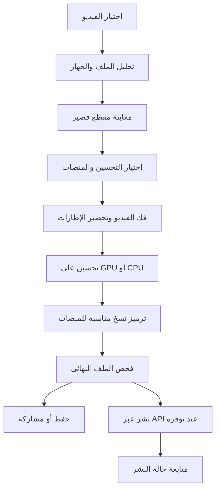

**دراسة تطبيق رفع جودة الفيديو وتجهيزه ونشره باستخدام Rust**

تاريخ مراجعة المصادر: 10 نوفمبر 2026. هذه الدراسة كُتبت قبل التنفيذ. بدأت بعدها نسخة حاسب عملية بـRust وLeptos وTauri مع معالجة FFmpeg تقليدية؛ تُتابَع حالة الميزات والاختبارات في [README](README.md). لا تعني اختبارات هذه النسخة إجراء مقارنة لنماذج AI أو قياس جودة الفيديو بعد ضغط المنصات. أرقام الوقت والتكلفة أدناه افتراضات تخطيطية، وليست نتائج اختبار أو عروض أسعار.

**القرار المقترح**

المشروع قابل للتنفيذ، وأوصي بنواة مشتركة بـRust، وواجهة Tauri 2 مع Leptos، وبداية على Windows وAndroid. يكون التحسين الثقيل على الحاسب، والتحسين الخفيف على الهاتف، مع إمكانية إرسال مهمة من الهاتف إلى حاسب المستخدم لاحقاً. تُضاف أنظمة Apple وLinux بعد إثبات جودة الصورة والأداء.

الوعد المناسب للمنتج هو: «حسّن الفيديو وجهّزه بأفضل إعدادات مناسبة لكل منصة». زيادة أبعاد الصورة، وتحسين تفاصيلها، وجودة عرضها بعد النشر ثلاثة أمور مختلفة. لا يضمن التطبيق استعادة التفاصيل الأصلية المفقودة، أو أن تعرض المنصة الملف بدقة الرفع نفسها؛ المنصة تتحكم في نسخ المشاهدة والترميز والتوزيع.

توضيح هدف المستخدم: المطلوب ريل أو ستوري يلفت المشاهد بوضوحه وتفاصيله وسلاسة حركته. لذلك تصبح جودة النسخة التي يشاهدها الناس بعد النشر معيار النجاح الأساسي. تُختار الإعدادات بناءً على الصورة والحركة بعد ضغط المنصة، مع الحفاظ على ملامح الأشخاص والكتابة والتفاصيل الطبيعية.

تأكيد معيار المستخدم: المطلوب أن تبقى النتيجة ممتازة حتى مع ضغط المنصة. تُترجم عبارة «بيرفكت، أعلى معايير» إلى هدف قابل للاختبار: أعلى جودة مشاهدة نستطيع تحقيقها ضمن قيود المنصة والمصدر، مع إعطاء الجودة الأولوية على سرعة المعالجة في وضع الجودة القصوى. لا تمثل هذه العبارة ضماناً بانعدام فقد التفاصيل لكل فيديو أو جهاز أو اتصال.

**تحسين الفيديو مع احتساب ضغط المنصة**

يدخل ضغط النشر في اختيار المعالجة وإعدادات التصدير منذ مرحلة التجربة. يولّد محرك Rust عدداً محدوداً من نسخ المعاينة بقوة تحسين وإعدادات ترميز مختلفة، ثم تُختبر محلياً تحت سيناريوهات ضغط تقريبية. تُقارن النتائج الواعدة بعد رفع فعلي مصرح به على حسابات الاختبار، وتُختار الإعدادات التي تحتفظ بأفضل توازن بين التفاصيل الطبيعية وثبات الصورة وسلاسة الحركة. المحاكاة أداة للفرز ولا تطابق خوارزمية المنصة أو تتنبأ بكل ظروف المشاهدة.

يتضمن معيار الجودة: قراءة النصوص الصغيرة، وثبات الشعر وملامح الوجه، وغياب الحواف المضيئة والتكتل الواضح وتدرجات اللون المتكسرة، وسلامة الحركة ومزامنة الصوت. يُفحص الريل والستوري بصورة منفصلة، وتُعاد المقارنة عند تغيير النموذج أو قالب التصدير. ويُختبر الناتج على أكثر من جهاز وفي ظروف مشاهدة مختلفة، مع تسجيل إعدادات التشغيل المتاحة حتى لا يُنسب اختلاف البث إلى التحسين نفسه.

لا يُعتمد إعداد عام بوصفه «الأفضل» بمجرد ارتفاع الدقة أو حجم الملف. يكون قرار الاعتماد مبنياً على جودة النسخة المنشورة ومقارنتها بالأصل وببدائل الإعدادات. في وضع الجودة القصوى يظهر تقدير الزمن والمساحة قبل التشغيل، وتبقى معاينة قصيرة متاحة قبل معالجة الفيديو كاملاً.

**تجربة الجودة المطلوبة للريل والستوري**

| ما يجب أن يلاحظه المشاهد | المعالجة المقترحة | معيار القبول |
|---|---|---|
| صورة نظيفة وواضحة | إزالة ضوضاء وآثار ضغط باعتدال قبل تحسين التفاصيل | بقاء ملمس البشرة والشعر والأقمشة دون مظهر شمعي |
| تفاصيل دقيقة وثابتة | نموذج تحسين يراعي الإطارات المتجاورة وحدود المشاهد | عدم ظهور وميض أو تغيّر مصطنع في الوجه والنصوص |
| حركة سلسة | الحفاظ على توقيت المصدر، واختبار توليد إطارات اختياري عند الحاجة | عدم ظهور صور مزدوجة أو أطراف مشوهة أو مزج بين مشهدين |
| ألوان وإضاءة متوازنة | معالجة ألوان محسوبة مع حفظ درجات البشرة والتفاصيل في الظلال والإضاءة | غياب التشبع الزائد وفقدان المناطق الفاتحة |
| نتيجة جيدة بعد النشر | مقارنة إعدادات تصدير فعلية للريل والستوري كل على حدة | تحسن مرئي في المشاهدة المنشورة مقارنةً برفع الأصل |

هذا تسلسل تصميم مقترح يُختبر على المقاطع، وليس سلسلة فلاتر قوية تُطبّق على كل ملف. رفع الحدة أو إزالة الضوضاء بإفراط قد يضر بالتفاصيل. والتوليد بالذكاء الاصطناعي يستطيع تقدير تفاصيل معقولة بصرياً، لكنه لا يثبت أنها التفاصيل الأصلية المفقودة. تكون الأولوية للمصدر الأصلي من الكاميرا عندما يتوفر.

**فرصة المنتج**

رفع الدقة وحده ميزة موجودة بالفعل: يقدم [Topaz Video](https://docs.topazlabs.com/topaz-video/quick-start) تحسين الفيديو على الحاسب، وتقدم [CapCut](https://www.capcut.com/tools/ai-video-upscaler) أداة لرفع الدقة. لذلك فإن فرصتنا المقترحة هي تجربة عربية واضحة، ومعالجة محلية، وتعاون الهاتف والحاسب، وإعداد نسخة مناسبة لكل منصة، ومعاينة النتيجة قبل إهدار وقت التصدير. هذا اقتراح تموضع يحتاج اختباراً مع مستخدمين، وليس إثباتاً لوجود طلب تجاري.

قبل الاستثمار الكبير: عرض نموذج على 10–15 صانع محتوى، ومراقبة جودة النتائج التي يفضلونها، والزمن المقبول لديهم، وهل سيدفعون مقابل هذه التجربة. لا يكفي أن يختاروا الصورة الأكثر حدة في لقطة ثابتة؛ يجب مشاهدة الحركة والوجوه والكتابة.

**كيف تكون Rust لغة المشروع؟**

اتجاه الواجهة معتمد: فحمي داكن، وزجاج ضبابي شبه شفاف داخل التطبيق، ونصوص بلون تيتانيوم فضي فاتح، والعربية افتراضياً مع الإنجليزية. تكون المعاينة محور الشاشة، وتُتجنب الزخرفة والأرقام المختلقة والقوالب التسويقية العامة. تُفصّل الألوان والتخطيط والسلوك في [مواصفات التصميم](DESIGN_AR.md).

| الجزء | الاختيار المقترح | المبرر وحدوده |
|---|---|---|
| منطق التطبيق ومحرك المهام | Rust | نواة واحدة للتحليل والمعالجة والتصدير والنشر |
| غلاف تطبيق الهاتف والحاسب | Tauri 2 | يدعم المنصات المكتبية والمحمولة، لكن التكامل مع نظام كل جهاز يبقى عملاً منفصلاً |
| الواجهة | Leptos بـRust مع HTML/CSS | يحافظ على معظم شيفرة التطبيق بـRust؛ تعمل الواجهة داخل WebView |
| تحليل وفك وترميز الفيديو | FFmpeg على الحاسب؛ تكامل مع وسائط النظام على الهاتف | يبدأ التنفيذ بمسار موثوق، ثم يقلل نقل البيانات بين CPU وGPU تدريجياً |
| استدلال الذكاء الاصطناعي | ONNX Runtime عبر مكتبة `ort` | واجهة Rust مجتمعية فوق محرك أصلي، وليست ضماناً لعمل كل نموذج على كل مسرّع |
| سجل المشروعات والمهام | SQLite | حفظ حالة العمل والملفات والإعدادات محلياً |
| الشبكة | `reqwest` و`tokio` | تسجيل الدخول ورفع الملفات والتعامل مع واجهات المنصات |
| خادم اختياري | Rust وAxum | عند الحاجة إلى أسرار OAuth أو تخزين مؤقت أو معالجة سحابية |

يدعم [Tauri](https://v2.tauri.app/start/) واجهات الويب ومنطق Rust، وله [دليل لاستخدام Leptos](https://v2.tauri.app/start/frontend/leptos/). دليل Leptos المنشور يشير إلى إصدار قديم، لذلك يجب اختبار إصدارات متوافقة وتثبيتها أثناء النموذج التقني. وقد نحتاج جسوراً صغيرة بـKotlin وSwift للوصول إلى خدمات الهاتف؛ يوضح [نظام إضافات Tauri](https://v2.tauri.app/develop/plugins/) هذا المسار. المشروع أساسه Rust، لكنه سيستخدم أيضاً مكتبات نظام ومحركات C/C++، بدلاً من إعادة كتابة الترميزات ومحرك الاستدلال.

**بنية المعالجة**

يفحص التحليل: الأبعاد، الاتجاه، نسبة البكسل، المدة، الترميز، توقيت الإطارات، الصوت، HDR، ومساحة التخزين. كما يفحص المحرك تسريع الجهاز فعلياً؛ وجود GPU لا يعني أن النموذج سيعمل عليه كاملاً.

تعمل المعالجة خارج مسار الواجهة، بقوائم محدودة الحجم حتى لا تتراكم الإطارات في الذاكرة. تُرسل إلى الواجهة حالة المهمة ومعاينات صغيرة، بدلاً من نقل كل إطار 4K عبر رسائل Tauri. يُحافظ على توقيت الصوت والصورة، وتُعالج الفيديوهات ذات معدل الإطارات المتغير دون انزياح الصوت.

أقترح فصل النواة إلى وحدات `media` و`inference` و`jobs` و`export` و`publish`، مع واجهات قابلة للاستبدال للمسرّعات والمنصات. وتُسجَّل هوية النموذج وإصداره وإعدادات التحسين مع كل مهمة لتكرار النتيجة.

**اختيار نموذج التحسين**

| المسار | استخدامه المقترح | ما يجب اختباره |
|---|---|---|
| Lanczos وتحسين خفيف | وضع سريع ومرجع للمقارنة | لا يضيف تفاصيل ذكية، وقد يكون كافياً لبعض المصادر |
| Real-ESRGAN | نموذج أولي لتحسين الإطارات واختبار الاستدلال | ظهور وميض أو تغيّر التفاصيل بين الإطارات عند تطبيقه بصورة مستقلة |
| RealBasicVSR أو نموذج زمني مناسب | مرشح لوضع الفيديو الأعلى جودة | جودة الحركة، الذاكرة، والتوافق مع محرك التشغيل |

يوفر [Real-ESRGAN](https://github.com/xinntao/Real-ESRGAN) نقطة بداية مفتوحة، بينما يستهدف [RealBasicVSR](https://github.com/ckkelvinchan/RealBasicVSR) تحسين فيديوهات العالم الحقيقي. اختيارهما للمقارنة لا يعني أنهما أفضل نماذج السوق الحالية. نشر نموذج زمني أصعب؛ يجب إثبات تصديره وتشغيل عملياته على المسرّع المختار قبل الالتزام به. وقد يتطلب ذلك تحويل بعض العمليات أو إضافة تنفيذ خاص بها.

يبدأ المنتج بتحسين ×2 وإخراج حتى 4K على الأجهزة التي تثبت قدرتها. الانتقال من 1080p إلى 4K يضاعف العرض والارتفاع ويزيد عدد البكسلات أربع مرات. أما ×4 في كل بُعد فيزيد عدد البكسلات 16 مرة؛ لذلك لا يصلح جعله الإعداد الافتراضي للهاتف.

تُستخدم معالجة البلاطات المتداخلة عند الحاجة لتقليل الذاكرة، مع فحص الحواف بين البلاطات. وتحتاج النماذج الزمنية إلى التعامل مع حدود المشاهد والمقاطع. بناءً على أولوية السلاسة، تدخل مقارنة توليد الإطارات في الإثبات التقني مبكراً، وتبقى ميزة اختيارية مرتبطة بجودة المقطع والمنصة. يُؤجَّل تحسين الوجوه التوليدي وتلوين الفيديو حتى تثبت الميزة الأساسية جودتها.

يمكن تقييم [RIFE](https://github.com/hzwer/ECCV2022-RIFE) بوصفه مرشحاً لتوليد إطارات بينية؛ ليس اختياراً نهائياً أو ادعاءً بأنه الأفضل حالياً. تغيير وسم الملف إلى 60fps أو تكرار الإطارات لا يضيف معلومات حركة جديدة. إن كان المصدر 60fps سليماً نحافظ عليه عند قبول مسار النشر له، وإن كان 30fps فنقارن الأصل بوضع 60fps مولّد فعلياً عند الحاجة. يجب كشف انتقالات المشاهد ومنع التوليد عبرها وفحص الحجب والحركة السريعة والوجوه والكتابة. وعند إخفاق المقطع في هذه الفحوص نحتفظ بمعدل المصدر. كذلك تُختبر جدوى توليد الإطارات قبل رفع الدقة أو بعده، لأن ذلك يؤثر في الزمن والنتيجة. معدل الملف المُصدَّر لا يضمن معدل الإطارات الذي ستعرضه المنصة للمشاهد.

**التسريع على الأجهزة**

| النظام | مسار التقييم المقترح |
|---|---|
| Windows | ONNX Runtime؛ اختبار CUDA على NVIDIA، وتقييم Windows ML للتغطية الأوسع |
| Android | اختبار نموذج خفيف مع CPU/XNNPACK ثم مسرّع مدعوم ومثبت على أجهزة فعلية؛ جسور نظام عند الحاجة |
| macOS وiOS | تقييم Core ML عبر ONNX Runtime أو مسار أصلي، مع اختبار العمليات ونقل البيانات |
| Linux | CPU وCUDA أولاً، وتوسيع دعم الأجهزة بعد قياس الحاجة |

توثق [ONNX Runtime](https://onnxruntime.ai/docs/execution-providers/) مزودي تنفيذ متعددين، وتقدم [`ort`](https://github.com/pykeio/ort) الربط مع Rust. لكن دعم المزود لا يكفي لإثبات دعم النموذج أو سرعة التنفيذ؛ يجب فحص العمليات التي تعود إلى CPU وكلفة النسخ بين الذاكرات.

توضح [وثائق DirectML](https://onnxruntime.ai/docs/execution-providers/DirectML-ExecutionProvider.html) أن تطوير الميزات الجديدة انتقل إلى Windows ML؛ يبقى DirectML خيار توافق، وليس الخيار الوحيد للتصميم الجديد. كما تصف [وثائق Android](https://developer.android.com/ndk/guides/neuralnetworks) NNAPI بأنه مهمل، لذلك لا أوصي ببناء خطة Android الجديدة عليه وحده. ويحتاج مسار [Core ML](https://onnxruntime.ai/docs/execution-providers/CoreML-ExecutionProvider.html) إلى اختبار دعم عمليات النموذج كذلك.

لا يُوعَد الهاتف بمعالجة كل فيديو 4K محلياً. تعرض الواجهة تقدير وقت بعد المعاينة، ووضعاً اقتصادياً، وإيقافاً آمناً عند الضغط الحراري. تُختبر مقاطعات التطبيق ومساحة التخزين وسلوك العمل في الخلفية. ويمكن لاحقاً إقران الهاتف بالحاسب لتشغيل المهمة على الحاسب بموافقة واضحة ورمز اقتران واتصال محمي.

**ماذا نستطيع نشره فعلياً؟**

الإعدادات التالية نقطة بداية للمنتج؛ ليست جميعها الحدود القصوى للمنصات. تختلف شروط التطبيق الرسمي عن شروط واجهة API، وقد تختلف حسب الحساب ونوع المنشور.

| المنصة | نسخة البداية المقترحة | النشر المباشر والحدود المهمة |
|---|---|---|
| YouTube | 4K عند فائدة التحسين، مع معدل إطارات المصدر | API رسمي وOAuth؛ تُختبر أهلية المشروع والحساب للنشر العام وحصص الاستخدام |
| Instagram Reels | 1080×1920 رأسي، H.264/AAC | حساب احترافي وصلاحيات نشر مناسبة؛ لا يُسوَّق 1080p بوصفه الحد الأقصى المطلق |
| Instagram Stories | قالب رأسي مستقل يبدأ بـ1080×1920 | تُراجع أهلية الحساب ومسار التفويض؛ لا تُنقل افتراضات نشر Reels إليه تلقائياً |
| TikTok | 1080×1920 أساساً، وتجربة 4K عند الحاجة | API يقبل أبعاداً أكبر، لكن النشر العام يخضع لمراجعة التطبيق وضوابط تجربة النشر |
| Facebook Reels | 1080×1920 رأسي | استهداف الصفحات عبر المسار الموثق؛ تأكيد شروط الإصدار المستخدم قبل الإطلاق |

يوصي [YouTube](https://support.google.com/youtube/answer/1722171?hl=en) بالحفاظ على معدل إطارات التسجيل، ويوفر إرشادات MP4 وH.264. توصيته لملفات SDR بدقة 4K هي 35–45Mbps عند 24–30fps و53–68Mbps عند 48–60fps. هذه معدلات رفع موصى بها، وليست ضماناً لمعدل بث المشاهدة. يوجد [مسار رسمي لرفع الفيديو](https://developers.google.com/youtube/data/reference/rest/v3/videos/insert)، كما توضح [مساعدة YouTube](https://support.google.com/youtube/answer/7300965?hl=en-GB) احتمال تقييد فيديوهات خدمات API غير الموثقة بالمشاهدة الخاصة؛ يجب التحقق من وضع مشروعنا عملياً قبل إعلان النشر العام.

توضح [مجموعة Meta الرسمية لـInstagram](https://www.postman.com/meta/instagram/documentation/6yqw8pt/instagram-api) دعم الحسابات الاحترافية. وتحدد [مواصفات Reels في المجموعة](https://www.postman.com/meta/instagram/folder/830j7my/reels-publishing) عرضاً أقصى 1920 بكسل، و23–60fps، ومعدل فيديو أقصى 25Mbps. لذلك لا يصح اعتبار ملف رأسي 2160×3840 متوافقاً تلقائياً مع هذا المسار. كما يَستخدم مسار `video_url` رابطاً تستطيع Meta جلبه؛ إذا اخترناه فسنحتاج استضافة مؤقتة للنسخة النهائية، حتى لو كانت المعالجة محلية. يجب أيضاً تقييم مسار الرفع الاستئنافي المتاح قبل تثبيت هذه البنية.

تفصل [وثائق Meta لمسار Instagram API with Facebook Login](https://www.postman.com/meta/instagram/documentation/6yqw8pt/instagram-api?entity=request-23987686-6fa9ed1d-3310-4844-ad25-f0001ab66f11) بين نشر المحتوى الاحترافي عموماً ونشر Stories، الذي تخصصه لحسابات الأعمال في ذلك المسار. لذلك يحتاج الستوري قالب تصدير واختبار جودة وفحص صلاحيات مستقلين. تبقى المشاركة من الهاتف مساراً متاحاً عندما تتوفر في التطبيق المستهدف، وتُراجع واجهات Stories الأخرى قبل الالتزام بالنشر المباشر لها.

تسمح [وثائق نقل الفيديو في TikTok](https://developers.tiktok.com/docs/en/content-posting-api-media-transfer-guide) بأبعاد 360–4096 بكسل لكل محور، و23–60fps، وحجم حتى 4GB؛ قبول الملف لا يضمن عرضه بالدقة نفسها. وتفرض [إرشادات النشر](https://developers.tiktok.com/docs/en/content-sharing-guidelines) قيوداً على التطبيقات غير المدققة، واختيار المستخدم للخصوصية، ومراجعة معلومات المنشئ وحدود مدته. كما تستبعد أداة داخلية مخصصة فقط لحسابات صاحبها أو فريقه من الاستخدام المقصود للنشر المباشر؛ إن كان المنتج شخصياً فالمشاركة إلى تطبيق TikTok هي مسار البداية الأنسب.

توثق [مجموعة Meta الرسمية لـFacebook](https://www.postman.com/meta/facebook/documentation/r56bjfd/facebook-api?entity=request-23987686-a9ea20fe-d410-4804-8bbe-5cc5985e9443) نشر Reels إلى الصفحات. لم تتوفر قراءة مباشرة لوثيقة Meta المرجعية أثناء البحث، كما أن أمثلة المجموعات قد تتأخر عن شروط الواجهة الحالية؛ لذلك لا أثبّت مدة قصوى أو حداً أعلى لدقة Facebook في هذه الدراسة. يُحسم ذلك من الوثيقة الحالية واختبار التكامل عند التنفيذ.

لا توجد موافقة واحدة تغطي كل المنصات. يبقى التصدير والمشاركة مفيدين منذ البداية، وتضاف واجهات النشر حسب صلاحيات الحساب ومراجعات التطبيقات. ولا يُستخدم اسم المستخدم وكلمة المرور لتسجيل الدخول؛ يُستخدم تفويض المنصة الرسمي.

**سياسة التصدير والجودة**

نحفظ مصدراً محسناً واحداً عندما يكون ذلك مجدياً، ثم نشتق منه نسخ المنصات، بدلاً من التحسين المكلف لكل منصة على حدة. وإذا اختلف القص الرأسي عن الأفقي، نحدد منطقة القص أولاً لتجنب معالجة أجزاء لن تظهر.

أقترح MP4 وH.264 وAAC كبداية للتوافق، مع التحقق من شروط كل منصة. يُحافظ افتراضياً على معدل إطارات المصدر ما دام مقبولاً، ويمكن اختيار وضع السلاسة بعد معاينة نتيجته والتحقق من شروط النشر. وتظهر القصوص الرأسية للمستخدم قبل التصدير. لا يُحوَّل HDR إلى SDR بمجرد تغيير وسم اللون؛ نحتاج مسار تحويل ألوان واختباراً بصرياً. وفي النسخة الأولى يمكن دعم SDR فقط مع كشف HDR وإبلاغ المستخدم بالخيارات المتاحة.

يملك كل قالب هوية تشمل المنصة ونوع المنشور: Reel أو Story، وأبعاد الإخراج، ومعدل الإطارات، والترميز وإعدادات الجودة. لا نعتبر أعلى bitrate أو أعلى دقة إعداداً أفضل تلقائياً. نقارن نسخاً محدودة الإعدادات برفع فعلي من حساب الاختبار، ثم نعتمد ما يعطي أفضل نتيجة منشورة. أي معاينة محلية تحاكي الضغط تُوسم بأنها تقديرية، ولا تُقدَّم بوصفها نسخة مطابقة لضغط المنصة.

يُفحص الملف النهائي بعد الترميز: إمكانية فتحه، الأبعاد، المدة، الصوت، تطابق المزامنة، وحدود المنصة. ويُفصل في الواجهة بين «اكتمل التصدير»، و«اكتمل رفع الملف»، و«تم النشر». وعندما لا تتيح المنصة التأكد من جاهزية أعلى دقة، يُعرض رابط المنشور للتحقق بدلاً من إعلان نجاح غير مثبت.

**حساب الزمن والذاكرة**

لدقيقة فيديو عند 30fps يوجد 1800 إطار. الأمثلة التالية افتراضية لتوضيح الحساب، ولا تمثل أداء نموذج أو جهاز معين:

| سرعة المعالجة الفعلية | زمن تحسين دقيقة واحدة، دون بقية المراحل |
|---|---|
| إطار واحد/ثانية | 30 دقيقة |
| 5 إطارات/ثانية | 6 دقائق |
| 15 إطاراً/ثانية | دقيقتان |

الزمن الكلي يشمل التحليل والتحضير والتحسين والترميز والرفع ومعالجة المنصة. وعند تداخل المراحل تؤثر أبطأ مرحلة في سرعة خط المعالجة؛ لذلك لا يكفي قياس النموذج وحده.

إطار 3840×2160 بصيغة RGB8 حجمه نحو 24.9MB، وحفظ 1800 إطار خام يحتاج نحو 44.8GB. أما تمثيل RGB بـfloat32 فحجمه نحو 99.5MB للإطار قبل ذاكرة النموذج ونتائجه الوسيطة. لهذا تُعالَج الإطارات تدريجياً، ولا تُحمَّل الدقيقة كاملة إلى RAM أو VRAM، ولا تُحوَّل افتراضياً إلى آلاف ملفات PNG مؤقتة.

**النسخة الأولى المقترحة**

1. استيراد MP4 وMOV ضمن الترميزات التي يثبت دعمها، وتحليل الملف تلقائياً.
2. معاينة مقطع 5–10 ثوانٍ ومقارنة الأصل والتحسين بالحركة.
3. وضع سريع ووضع تحسين ×2؛ حد إخراج يصل إلى 4K على الحاسب المؤهل، وحدود الهاتف حسب اختبارات الأجهزة.
4. قص رأسي وأفقي بإشراف المستخدم، وقوالب للمنصات الأربع، مع فصل Reel عن Story.
5. صف مهام، وإلغاء، واستعادة حالة العمل بعد التعطل. استئناف التحسين من منتصف الفيديو يحتاج تقسيمات ونقاط تحقق مصممة لذلك؛ حفظ الحالة وحده لا يحققه.
6. حفظ الملف والمشاركة إلى تطبيقات الهاتف المتاحة، ثم موصل نشر رسمي واحد يُختار بعد اختبار الحسابات.
7. واجهة عربية تدعم اتجاه الكتابة، مع تقدير الزمن والحجم ومساحة التخزين المطلوبة.
8. وضع سلاسة اختياري يدخل النسخة التجريبية إذا اجتاز مقارنة الجودة والتوافق؛ يبقى توقيت الفيديو والصوت صحيحاً سواء فُعِّل أم لا.

تؤجَّل المعالجة السحابية العامة، والجدولة الشاملة، والمحرر الزمني المتقدم، ودعم كل الأنظمة دفعة واحدة. يظل مسار الوصول إليها موجوداً في التصميم دون جعلها شرطاً لإثبات الفكرة.

**خطة التنفيذ والتكلفة**

| المرحلة | تقدير تخطيطي | شرط الانتقال |
|---|---|---|
| إثبات تقني | 2–3 أسابيع | تشغيل نموذج من Rust، وقياس السرعة والذاكرة، ومقارنة السلاسة والنتيجة بعد النشر ومراجعة التراخيص |
| إصدار Windows تجريبي | 5–7 أسابيع | استيراد ومعاينة وتحسين وتصدير موثوق |
| إصدار Android تجريبي | 4–6 أسابيع | تكامل الملفات والمشاركة واختبار أجهزة متفاوتة |
| تكامل النشر | 3–5 أسابيع | تحقق OAuth والرفع وحالة النشر على الحسابات المقصودة |
| اختبار وإصلاح وإعداد التوزيع | 2–3 أسابيع | اجتياز معايير القبول وتثبيت الحزم |

المجموع التسلسلي 16–24 أسبوعاً. هذا تقدير أولي لنسخة محدودة على Windows وAndroid بفريق صغير ذي خبرة؛ قد تتداخل أعمال الواجهة والهاتف، وقد يمتد العمل إذا احتاج النموذج إلى عمليات مخصصة. انتظار موافقات المنصات خارج هذا التقدير. يُعاد تقدير الجدول بعد الإثبات التقني. بناء إصدارات Apple يحتاج بيئة البناء والتوقيع المناسبة، كما توضّح [متطلبات Tauri](https://v2.tauri.app/start/prerequisites/).

أولوية السلاسة وإضافة Stories توسع الاختبارات المطلوبة. لا يشمل الرقم السابق وعداً بموعد ثابت لوضع توليد الإطارات أو جميع واجهات Stories؛ يُحدَّث التقدير بعد اختبار تشغيل نموذج الحركة من Rust، وأدائه على الأجهزة، وحدود النشر الفعلية.

ميزانية التطوير = أشهر عمل الفريق × كلفة الشهر المتفق عليها، مع إضافة أجهزة الاختبار والتوزيع والدعم. لا أعطي رقماً سوقياً دون معرفة الفريق والمواصفات. لا تحتاج المعالجة المحلية إلى دفع مقابل كل دقيقة GPU للمزود، لكنها تستهلك موارد المستخدم وتستلزم صيانة وتوزيعاً.

إذا أضفنا السحابة: كلفة المهمة = ساعات GPU الفعلية × سعر الساعة + التخزين + نقل البيانات + كلفة الإخفاق وإعادة المحاولة. مثال حسابي فقط: عند سعر مفترض 1 دولار/ساعة وسرعة مفترضة 5fps، يحتاج تحسين دقيقة 30fps إلى 0.1 ساعة، أي 0.10 دولار لحساب التحسين وحده. يجب القياس على النموذج الحقيقي قبل تسعير الخدمة؛ هذا ليس سعر مزود حالي.

كنموذج تجاري أولي، أقترح ترخيصاً أو اشتراكاً للمعالجة المحلية، ورصيداً منفصلاً للسحابة عند إضافتها. تُختبر رغبة المستخدمين بالدفع قبل تثبيت السعر، ولا يُباع وعد «دقة قصوى مضمونة على كل منصة».

**مخاطر يجب حسمها داخل التنفيذ**

| الخطر | الإجراء المقترح |
|---|---|
| تفاصيل مصطنعة أو وجوه وكتابة تتغير | معاينة حركة، قوة تحسين قابلة للتقليل، ومقارنة مع تكبير تقليدي |
| النموذج يعمل لكنه بطيء | فحص رجوع العمليات إلى CPU ونقل الذاكرة، ثم اختيار نموذج أخف |
| سخونة الهاتف أو انقطاع المهمة | حدود حسب الجهاز وحفظ حالة وتقسيم عمل عند الحاجة |
| نشر مكرر بعد انقطاع الشبكة | حفظ معرّفات الرفع والمنشور وفحص الحالة قبل إعادة النشر |
| تغيّر شروط المنصة | إعدادات تصدير ذات إصدار وموصل مستقل واختبارات تكامل |
| تسريب ملفات أو رموز دخول | معالجة محلية افتراضياً، ومخزن أسرار النظام، وحجب الأسرار من السجلات |
| تضخم مساحة الملفات | تقدير المساحة، وتدفق محدود، وتنظيف الملفات المؤقتة التابعة للمهمة |

يجب مراجعة تراخيص الشيفرة وأوزان النماذج والتبعيات قبل التوزيع التجاري. وتختلف متطلبات FFmpeg حسب خيارات البناء؛ توضح [وثيقته الرسمية](https://ffmpeg.org/legal.html) الفرق بين LGPL والمكونات الاختيارية التي تفعّل GPL. توضع خطة توزيع واضحة تشمل الإشعارات والمصدر المطلوب وخيارات الربط؛ كتابة التطبيق بـRust لا تلغي التزامات مكتباته.

**اختبارات القبول المقترحة**

نستخدم 20 مقطعاً قصيراً متنوعة تشمل وجوهاً وكتابة عربية وحركة سريعة وإضاءة ضعيفة وأنمي، إضافة إلى مقاطع طويلة لاختبار المزامنة والذاكرة. تُسجل هوية الجهاز والنموذج وسرعة المعالجة وأقصى استهلاك للذاكرة مع كل تجربة. تُقارن النتائج بتكبير تقليدي وبنموذج منافس متاح للمقارنة عند الحاجة، ولا نفترض جودة تجارية مساوية للمنتجات الأخرى مسبقاً.

نقيس الزمن الكلي، واستهلاك RAM وVRAM، وحجم الملف، وانزياح الصوت، والوميض وتغيّر التفاصيل. يمكن استخدام PSNR/SSIM أو مقاييس إدراكية عند وجود مرجع مناسب؛ الفيديو الرديء الحقيقي غالباً لا يملك نسخة أصلية مرجعية، لذا يلزم تقييم بصري للحركة. ويُعاد تقييم عينات بعد ترميز المنصة، لأن جودة الملف المحلي وحدها لا تثبت جودة المشاهدة المنشورة.

لاختبار الانطباع الذي يطلبه المستخدم، تُعرض مقارنات لا تكشف أي نسخة محسنة على مجموعة المشاهدين: الأصل المنشور، والتحسين المنشور، والتحسين مع السلاسة عند توفره. تُقارن النسخ على الجهاز نفسه وفي ظروف مشاهدة متقاربة، ويُفصل اختبار Stories عن Reels. نسأل عن وضوح التفاصيل وطبيعية الوجه وسلاسة الحركة، ونعتمد الإعداد الذي يفضله معظم المشاركين دون تشوهات واضحة. إذا لم يبق فرق مفيد بعد النشر، نراجع إعدادات المعالجة والتصدير قبل إضافة مزايا أخرى.

لا ينتقل المشروع إلى توسيع الأنظمة قبل إثبات ثلاث نتائج: تحسن بصري مفيد على عينات المستخدمين، وزمن مقبول على الأجهزة المستهدفة، ومسار نشر أو مشاركة موثوق على الحسابات المطلوبة. الخطوة التنفيذية الأولى المقترحة هي نموذج Rust على Windows يعالج مقطعاً قصيراً ويُخرج تقرير الأداء والمقارنة؛ على أساسه نثبت النموذج وخطة الهاتف.
